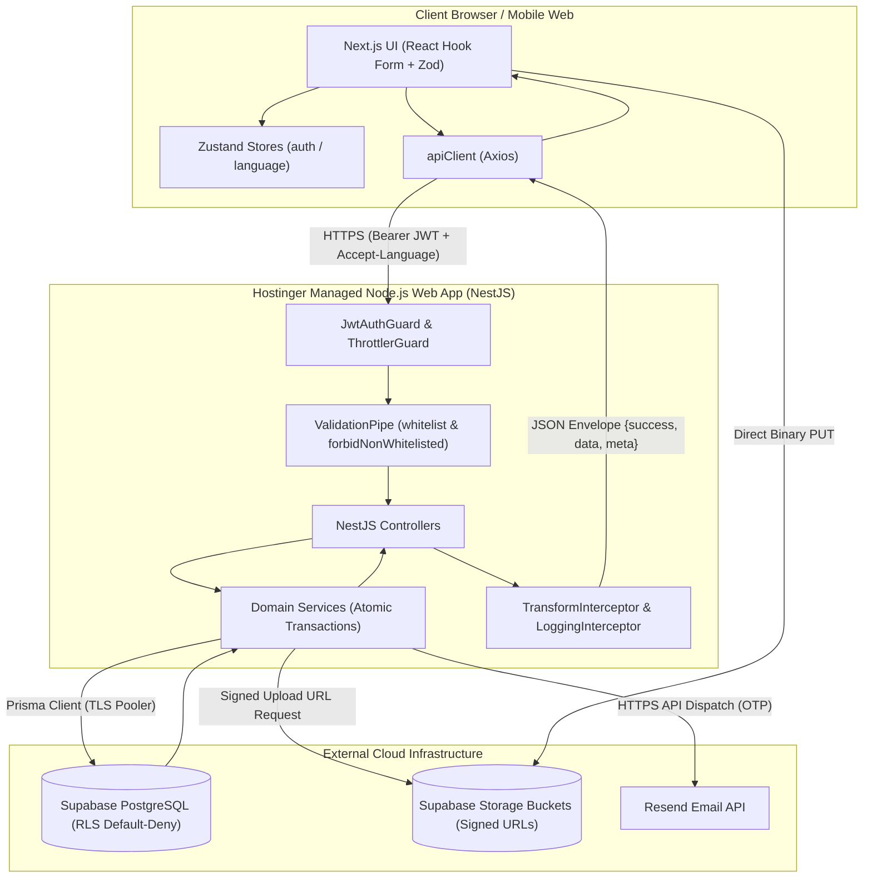
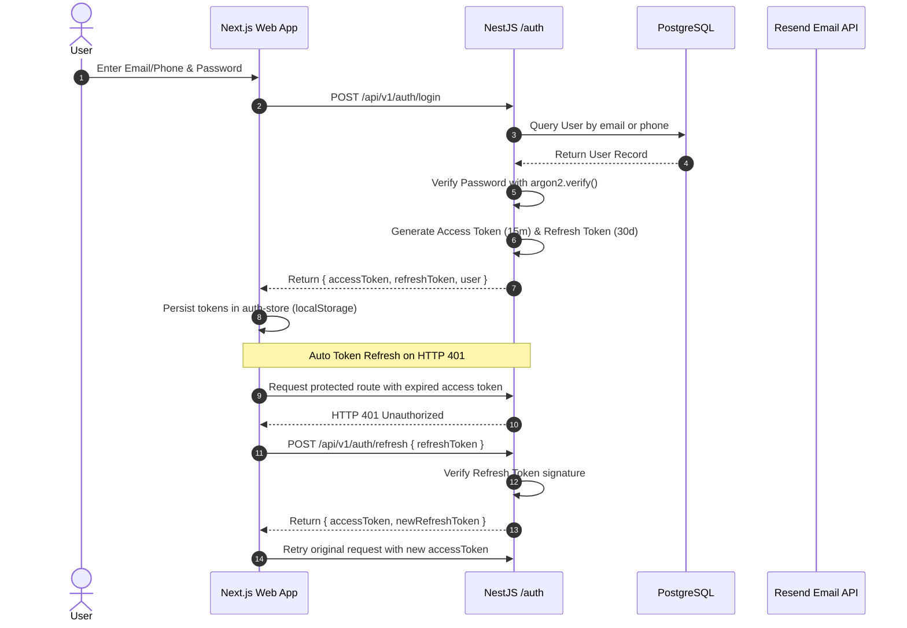
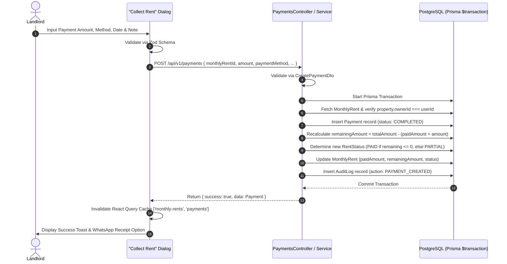
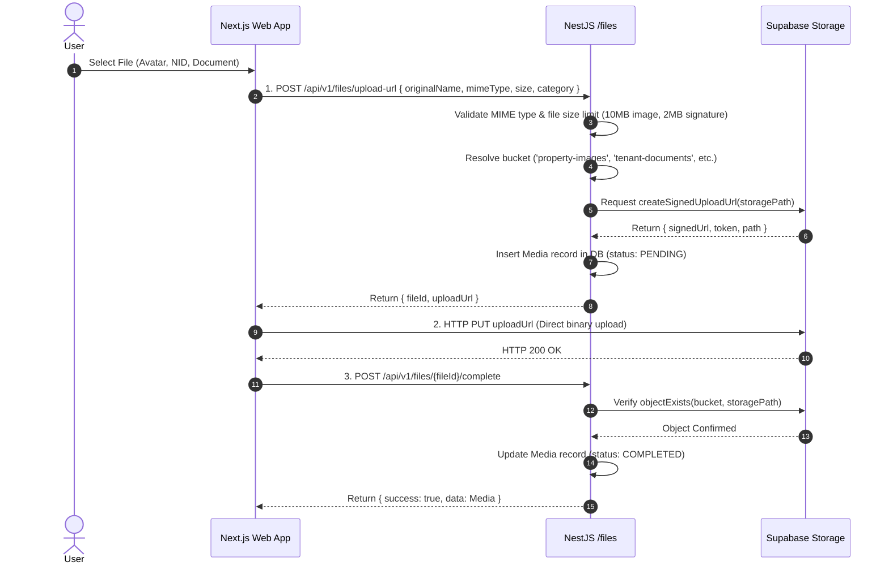

# Data Flow

## 1. Overview

Data in BariVara moves through a decoupled client-server architecture:
- The **Next.js frontend** (`barivara-web`) renders server and client components, manages form state via React Hook Form and Zod, and issues HTTP requests via an Axios client with auto-refreshing JWT authentication.
- The **NestJS backend** (`barivara-api`) validates incoming payloads with strict class-validator DTOs, verifies ownership isolation, executes database mutations inside atomic Prisma transactions, and formats responses into standard bilingual envelopes.
- **Supabase PostgreSQL** persists relational entities, while **Supabase Storage** holds document and image binaries uploaded directly by the client using pre-signed upload URLs.

---

## 2. System-Level Data Flow



---

## 3. Authentication Flow



---

## 4. Create Data Flow (Example: Recording Rent Payment)



---

## 5. Read Data Flow

1. **User requests a dashboard or list page** (e.g. `/rents`).
2. **TanStack React Query** invokes the corresponding API method in `apiClient`.
3. **Axios interceptor** attaches `Authorization: Bearer <accessToken>` and `Accept-Language: bn` (or `en`).
4. **Backend `JwtAuthGuard`** decodes the JWT and attaches `user: CurrentUserPayload` to the request.
5. **Service method executes query**:
   - Applies tenant ownership filter: `where: { agreement: { unit: { property: { ownerId: userId } } } }`.
   - Executes pagination: `skip: (page - 1) * limit, take: limit`.
   - Optionally runs lazy overdue update: `refreshOverdueStatuses(userId)`.
6. **Backend `TransformInterceptor`**:
   - Converts all Prisma `Decimal` instances into plain JSON numbers.
   - Wraps payload in `{ success: true, message: "...", data: [...], meta: { page, limit, total, totalPages } }`.
7. **Frontend updates cache and re-renders table/cards**.

---

## 6. Update Data Flow

1. User modifies an entity in an edit modal (e.g. `PATCH /rental-agreements/:id`).
2. Frontend ensures only permitted, updateable fields are transmitted.
3. Backend controller validates fields against the corresponding `Update...Dto`.
4. Service verifies resource ownership (`ownerId === userId`).
5. Updates execute inside a transaction if side effects exist (e.g. updating unit status from `VACANT` to `OCCUPIED`).
6. Updated record is returned and React Query cache is invalidated.

---

## 7. Delete Flow (Soft Deletion)

BariVara uses **soft deletion** on business entities:
1. `DELETE /api/v1/properties/:id`, `DELETE /api/v1/units/:id`, `DELETE /api/v1/tenants/:id`.
2. Backend verifies ownership.
3. Instead of running SQL `DELETE`, backend executes `prisma.<entity>.update({ where: { id }, data: { deletedAt: new Date() } })`.
4. Subsequent queries automatically filter records with `{ deletedAt: null }`.
5. Hard deletes are reserved exclusively for file metadata when objects are purged from Supabase Storage.

---

## 8. External Services Integration Flow

### Resend Email (OTP Flow)
1. User clicks "Forgot Password" on `/forgot-password`.
2. Backend generates a cryptographically secure 6-digit numeric OTP.
3. Stored in memory map (`pendingOtps`) with a 10-minute expiry.
4. Backend formats bilingual HTML email and invokes Resend HTTPS API (`resend.emails.send()`).
5. User enters OTP on `/verify-password-reset-otp` to receive a temporary reset session token.

### WhatsApp Web Direct Dispatch
1. When rent is collected, frontend invokes `generateWhatsAppReceiptMessage()` (`barivara-web/src/lib/whatsapp-receipt.ts`).
2. Formats a full Bengali rent receipt with tenant name, flat number, month/year, total rent, amount collected, remaining dues, and payment date.
3. Opens browser window with `https://wa.me/{tenantPhone}?text={encodedText}` directly dispatching the receipt to the tenant's WhatsApp without backend SMS gateway overhead.

---

## 9. File & Storage Flow (3-Step Upload Lifecycle)



---

## 10. Realtime & Background Flow

- **No WebSocket / Realtime Subscriptions**: All state is managed request-driven via TanStack React Query polling and window focus refetching.
- **No Background Daemon Process**: Overdue status updates are lazily evaluated during read operations (`refreshOverdueStatuses`).

---

## 11. Security Boundaries

1. **Transport Layer**: All communication forced over HTTPS/TLS.
2. **Network Perimeter**: Supabase PostgreSQL connections require SSL (`sslmode=require`).
3. **Application Perimeter**:
   - `Helmet` sets standard security headers.
   - `ThrottlerGuard` applies IP-based rate limiting on sensitive authentication routes.
   - `ValidationPipe` with `forbidNonWhitelisted: true` rejects unexpected body fields.
4. **Data Layer**:
   - Row-Level Security enabled with public PostgREST disabled.
   - Strict application-level ownership verification on all operations.

---

## 12. Important Data Transformations

1. **Decimal to Number Serialization**:
   - Handled globally by `TransformInterceptor`:
     ```typescript
     DecimalUtil.transformDecimals(data)
     ```
   - Automatically traverses objects and arrays, converting Prisma `Decimal` instances to standard JSON numbers for client consumption.
2. **Date Clamping**:
   - `DateUtil.calculateDueDate(year, month, dueDay)` automatically clamps due days to the maximum valid calendar day (e.g., February 28/29).

---

## 13. Unknown / Unverified Flows

- Real-time push notifications or mobile background sync flows are not implemented in the current repository code.
