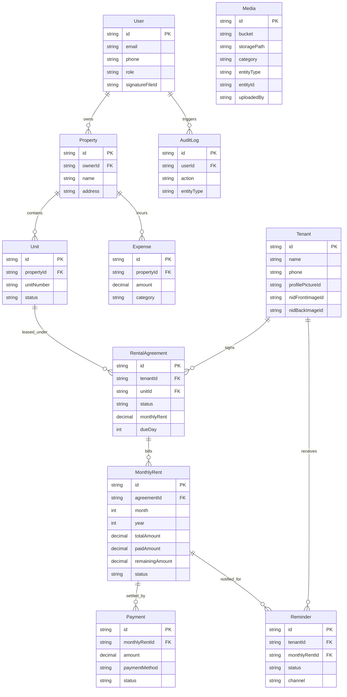

# Data Relationships

## 1. Relationship Overview

The BariVara data model is structured around a top-down landlord ownership hierarchy:
- A **User** (landlord) owns multiple **Properties**.
- Each **Property** contains multiple rentable **Units** (flats/rooms) and tracks property-level **Expenses**.
- A **Tenant** represents an individual renter, independent of properties until leased.
- A **RentalAgreement** forms the bridge between a **Tenant** and a **Unit**.
- Active rental agreements generate periodic **MonthlyRent** records (invoices).
- A **MonthlyRent** invoice receives one or more **Payment** records until fully settled.
- **Reminders** are linked to tenants and optionally to specific monthly rent invoices.
- **AuditLog** records capture actions performed by users.
- **Media** records provide file attachments for users (signatures), properties, tenants (NID/photo), agreements (leases), and payments (vouchers/receipts).

---

## 2. Entity Relationship Diagram



---

## 3. Relationship Details

### User $\to$ Property
- **Relationship**: Landlord ownership
- **Foreign Key**: `properties.ownerId` $\to$ `users.id`
- **Cardinality**: One-to-Many (`1 : N`)
- **Delete Rule**: `Cascade` (deleting user removes all owned properties)
- **Purpose**: Establishes tenant isolation and multi-tenant scoping boundary.

### Property $\to$ Unit
- **Relationship**: Building partitioning
- **Foreign Key**: `units.propertyId` $\to$ `properties.id`
- **Cardinality**: One-to-Many (`1 : N`)
- **Delete Rule**: `Cascade`
- **Purpose**: Represents individual flats, rooms, or spaces inside a building.

### Property $\to$ Expense
- **Relationship**: Property operational costs
- **Foreign Key**: `expenses.propertyId` $\to$ `properties.id`
- **Cardinality**: One-to-Many (`1 : N`)
- **Delete Rule**: `Cascade`
- **Purpose**: Tracks utility and maintenance expenses incurred by the property.

### Tenant $\to$ RentalAgreement
- **Relationship**: Tenant contract involvement
- **Foreign Key**: `rental_agreements.tenantId` $\to$ `tenants.id`
- **Cardinality**: One-to-Many (`1 : N`)
- **Delete Rule**: `Cascade`
- **Purpose**: Connects a tenant's identity and ledger to a lease contract.

### Unit $\to$ RentalAgreement
- **Relationship**: Unit leasing
- **Foreign Key**: `rental_agreements.unitId` $\to$ `units.id`
- **Cardinality**: One-to-Many (`1 : N`)
- **Delete Rule**: `Cascade`
- **Purpose**: Links a physical unit to its tenancy terms. Only one agreement can be `ACTIVE` on a unit at a given time.

### RentalAgreement $\to$ MonthlyRent
- **Relationship**: Periodic rent billing
- **Foreign Key**: `monthly_rents.agreementId` $\to$ `rental_agreements.id`
- **Cardinality**: One-to-Many (`1 : N`)
- **Delete Rule**: `Cascade`
- **Purpose**: Generates recurring monthly rent bills for an agreement.

### MonthlyRent $\to$ Payment
- **Relationship**: Bill collection & settlement
- **Foreign Key**: `payments.monthlyRentId` $\to$ `monthly_rents.id`
- **Cardinality**: One-to-Many (`1 : N`)
- **Delete Rule**: `Cascade`
- **Purpose**: Append-only log of payments made against a specific monthly rent invoice.

### MonthlyRent $\to$ Reminder
- **Relationship**: Rent notification
- **Foreign Key**: `reminders.monthlyRentId` $\to$ `monthly_rents.id`
- **Cardinality**: Zero/One-to-Many (`0..1 : N`)
- **Delete Rule**: `SetNull`
- **Purpose**: Optional reference associating a reminder message with a specific pending or overdue rent bill.

### Tenant $\to$ Reminder
- **Relationship**: Notification recipient
- **Foreign Key**: `reminders.tenantId` $\to$ `tenants.id`
- **Cardinality**: One-to-Many (`1 : N`)
- **Delete Rule**: `Cascade`
- **Purpose**: Targets a specific tenant for scheduled notifications.

### User $\to$ AuditLog
- **Relationship**: Actor activity logging
- **Foreign Key**: `audit_logs.userId` $\to$ `users.id`
- **Cardinality**: Zero/One-to-Many (`0..1 : N`)
- **Delete Rule**: `SetNull`
- **Purpose**: Attributes security and financial mutations to the authenticated user.

---

## 4. Authentication Relationships

- All authenticated routes resolve `User` via the JWT payload claim `sub` (user UUID).
- Ownership authorization relies on traversing the relational graph from the target resource back to `User.id`:
  - `Property`: `property.ownerId === user.id`
  - `Unit`: `unit.property.ownerId === user.id`
  - `RentalAgreement`: `agreement.unit.property.ownerId === user.id`
  - `MonthlyRent`: `rent.agreement.unit.property.ownerId === user.id`
  - `Payment`: `payment.monthlyRent.agreement.unit.property.ownerId === user.id`

---

## 5. Ownership Relationships

```text
User (Owner)
  ├── Properties
  │     ├── Units
  │     │     └── Rental Agreements
  │     │           ├── Monthly Rents
  │     │           │     ├── Payments
  │     │           │     └── Reminders
  │     └── Expenses
  └── Audit Logs
```

---

## 6. Dependency Relationships

1. **Unit Status depends on Rental Agreements**:
   - Creating an `ACTIVE` agreement transitions `Unit.status` from `VACANT` to `OCCUPIED`.
   - Ending or cancelling the agreement transitions `Unit.status` back to `VACANT`.
2. **MonthlyRent Status depends on Payments & Dates**:
   - `paidAmount == 0 && today <= dueDate` $\to$ `PENDING`
   - `paidAmount == 0 && today > dueDate` $\to$ `OVERDUE`
   - `paidAmount > 0 && paidAmount < totalAmount` $\to$ `PARTIAL`
   - `paidAmount >= totalAmount` $\to$ `PAID`

---

## 7. Unverified Relationships

- **Tenant ownership**: Tenants do not have a direct `ownerId` column in the database schema; they are isolated via their associated rental agreements and unit properties.
- **Media foreign keys**: `Media` records do not enforce strict foreign key constraints on `entityId` to maintain polymorphic attachment flexibility across users, tenants, and properties.
